# FDV-2DCamera

*Fundamentos del Desarrollo de Videojuegos*' assignment: 2D Cinemachine cameras.

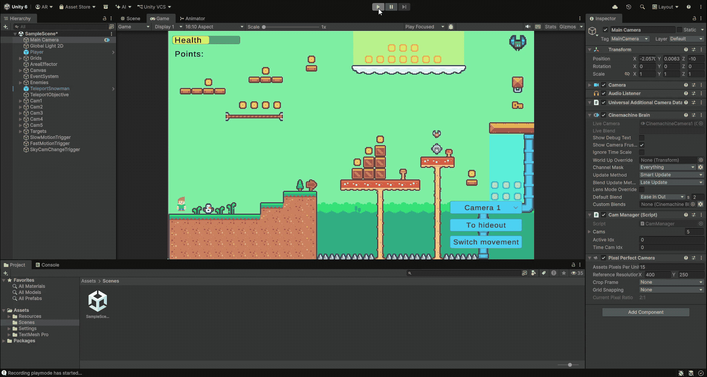

> Game cameras are very important for the end product quality, since they control the game's view. Managing the cameras correctly ensures coherent visual effects without confusing the players. They can be configured, and by using scripts they can achieve a large variety of effects. Each type of game will have a different camera behaviour.
> - For a puzzle game, the camera might be static to keep a complete view of the puzzle.
> - For a first person shooter, it should be linked to the player's character at the eye level.
> - For a racing game, it should always follow the player's car.

> In this assignment we'll work on the typical 2D camera effects.

## Table of contents
1. [Task 1](#task-1)
2. [Task 2](#task-2)
3. [Task 3](#task-3)
4. [Task 4](#task-4)
5. [Task 5](#task-5)
6. [Task 6](#task-6)
7. [Task 7](#task-7)

## Task 1

> Install the Cinemachine package and configure two virtual cameras with different player following zones. Show the effect with an animated GIF.

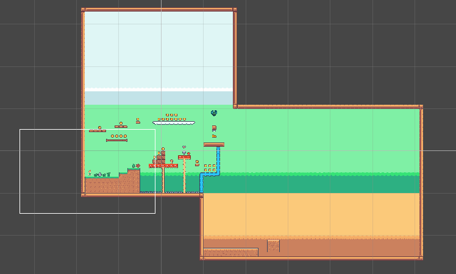

For this task I expanded a bit the map so that we can properly see the differences in camera settings. The first camera has the following effect:

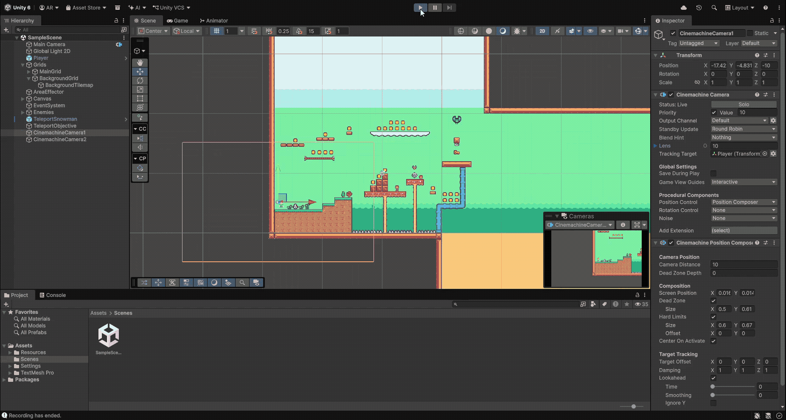

It is set to have a dead zone of (0.5, 0.61), and hard limits at (0.6, 0.67).

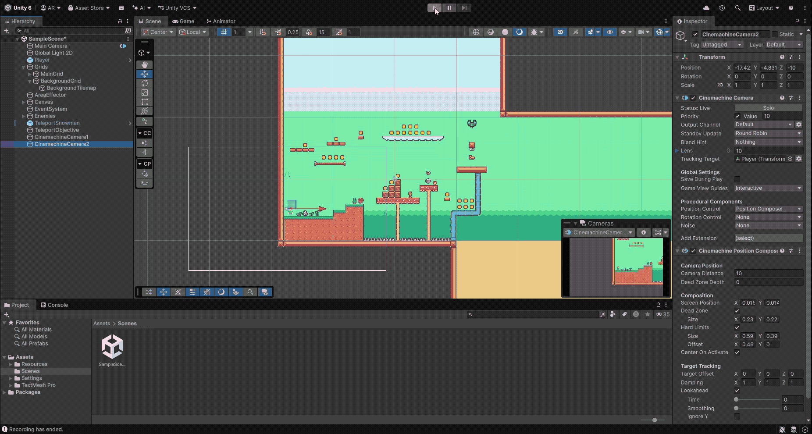

This second camera is a bit more aggressive: it has a smaller dead zone of (0.23, 0.22) and hard limits at (0.59, 0.39) with a slight X offset of 0.46. To switch between the cameras I simply adjust their priorities in the inspector.

## Task 2

> Define a confinement area for each of the two cameras of the previous task. Test the execution with its corresponding animated GIF that allows us to see the differences.

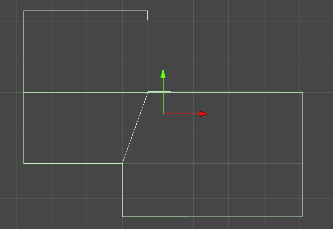

For this task I defined a box collider that spans the entire green section for the first camera, so that it doesn't enter neither the snow nor the desert regions:

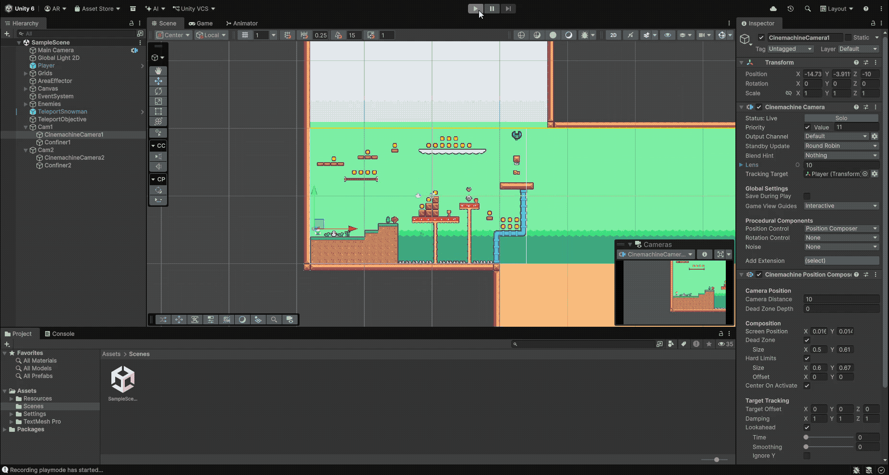

For the second camera, I set up a polygon collider covering the map bounds, which allows the camera to move freely inbetween sections:

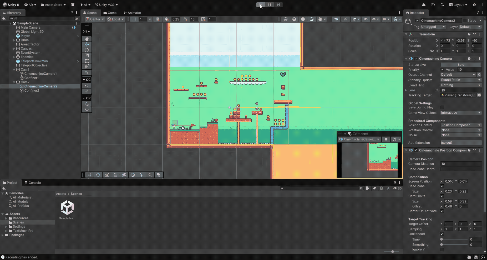

Note how the second camera tries to avoid showing the outside as much as possible. When it can't, it snaps to a new position very rapidly.

Both colliders were set to triggers so that they do not affect the dynamic objects in the scene.

## Task 3

> Add various moving sprites in the scene (at least 3). Add an additional camera that follows all of them.
> Add two additional moving sprites. Add another camera that follows them, but with different importance weights.

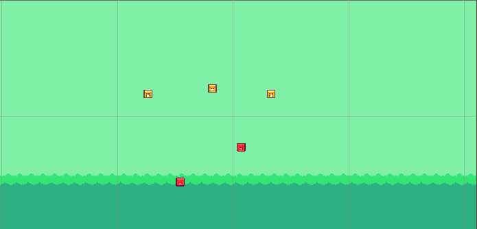

For this task I created a new [`BackAndForthObject`](Assets/Resources/Scripts/BackAndForthObject.cs) script that simply describes a movement around a starting position using sinusoidal functions:

```c#
using Unity.Mathematics;
using UnityEngine;

public class BackAndForthObject : MonoBehaviour
{
    public float speedX = 1.0f;
    public float offX = 10f;
    public float speedY = 1.0f;
    public float offY = 10f;

    private Vector2 pivot;
    private float phaseX = 0.0f;
    private float phaseY = 0.0f;

    void Start()
    {
        pivot = transform.position;
    }

    void Update()
    {
        phaseX += Time.deltaTime * speedX;
        phaseY += Time.deltaTime * speedY;
        Vector2 offset = new(
            offX * math.cos(phaseX), 
            offY * math.sin(phaseY)
        );
        transform.position = pivot + offset;
    }
}
```

The first new camera follows the first three objects. They all have the same weight, so the camera tries to adjust itself equally based on their positions:

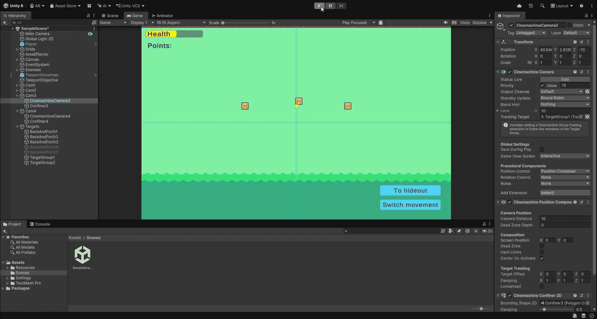

This is achieved using an empty object with the `Cinemachine Target Group` component. Each of the three new objects have their weights set to 1:

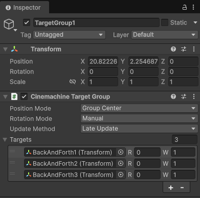

The second new camera follows the three objects, plus two more. The two new objects have bigger weights, so the camera focuses more on them:

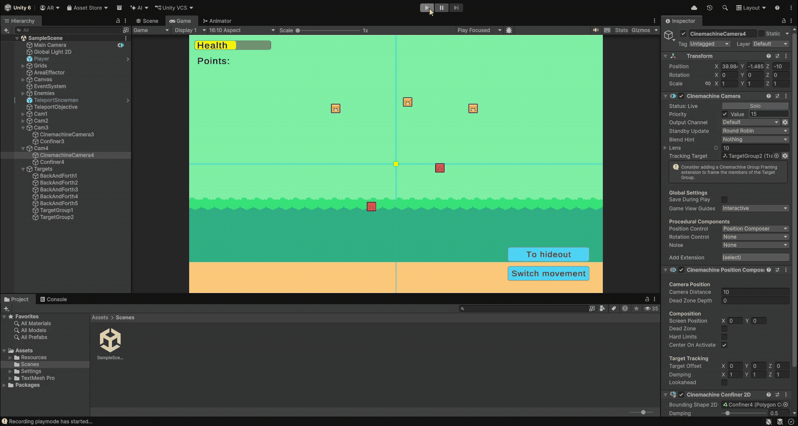

A new `Cinemachine Target Group` was needed for this extra camera. The fourth object has a weight of 2, and the fifth object has a weight of 3:

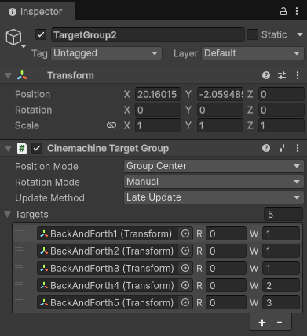

## Task 4

> Implement a zoom effect for the player camera that is controlled with the `W` and `S` keys.

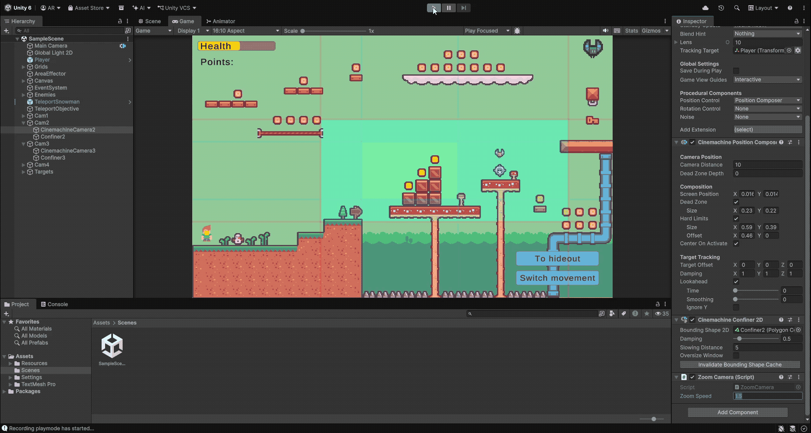

This task is quite simple. I added a new [`ZoomCamera`](Assets/Resources/Scripts/ZoomCamera.cs) script that is meant fo be added to the `CinemachineCamera` objects in the scene:

```c#
using UnityEngine;
using Unity.Cinemachine;
using Unity.Mathematics;

[RequireComponent (typeof(CinemachineCamera))]
public class ZoomCamera : MonoBehaviour
{
    public const float minZoom = 5;
    public const float maxZoom = 10;
    public float zoomSpeed = 1.0f;

    private CinemachineCamera cam;

    void Start()
    {
        cam = GetComponent<CinemachineCamera>();
    }

    void Update()
    {
        if (!cam.isActiveAndEnabled) { return; }
        float zoom = 0.0f;
        if (Input.GetKey(KeyCode.Q)) {
            zoom += zoomSpeed * Time.deltaTime;
        } else if (Input.GetKey(KeyCode.E)) {
            zoom -= zoomSpeed * Time.deltaTime;
        }
        cam.Lens.OrthographicSize = math.clamp(
            cam.Lens.OrthographicSize + zoom,
            minZoom,
            maxZoom
        );
    }
}
```

Instead of using `W` and `S`, this script uses `Q` and `E`. The zoom values are clamped so that elements onscreen don't get too big or too small.

## Task 5

> Select a set of keys that may allow you to change between two cameras (enabling/disabling the virtual camera's gameObject).
> Implement a UI that includes some element to select which camera gets activated.

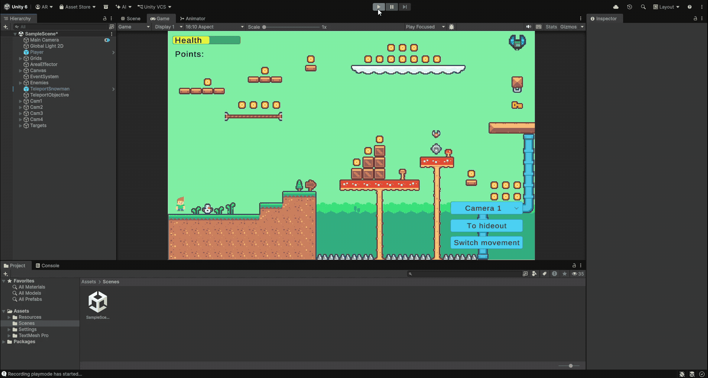

For this combined task, I added a [`CamManager`](Assets/Resources/Scripts/CamManager.cs) script to the Main Camera:

```c#
using UnityEngine;
using Unity.Cinemachine;

public class CamManager : MonoBehaviour
{
    public CinemachineCamera[] cams;
    public int activeIdx = 0;

    void Start()
    {
        if (cams == null) {
            Debug.LogError("CamManager: cams is null!");
            return;
        }
        for (int i = 0; i < cams.Length; i++) {
            var cam = cams[i];
            if (cam == null) { Debug.LogError("Cam " + i + " is null!"); }            
        }
        SetActiveCam(activeIdx);
    }

    void Update()
    {
        if (Input.GetKey(KeyCode.Alpha0)) {
            SetActiveCam(0);
        } else if (Input.GetKey(KeyCode.Alpha3)) {
            SetActiveCam(3);
        }
    }

    public void SetActiveCam(int index) {
        activeIdx = index;
        for (int i = 0; i < cams.Length; i++) {
            cams[i].gameObject.SetActive(i == index);
        }
    }
}
```

It contains a public array of the cameras we want to enable/disable. When we want the camera to change, we can call `SetActiveCam` with the corresponding camera's index. As an example, I added the checks for the `0` and `3` keys to `Update`. Finally, the UI camera dropdown's `OnValueChanged` event is set up to call our `SetActiveCam`:

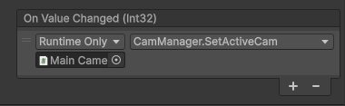

## Task 6

> Create a script to enable the slow motion camera whenever the character collides with a scene element of your choosing to enable this property.
> Create a script to enable the fast motion camera whenever the character collides with a scene element of your choosing to enable this property.

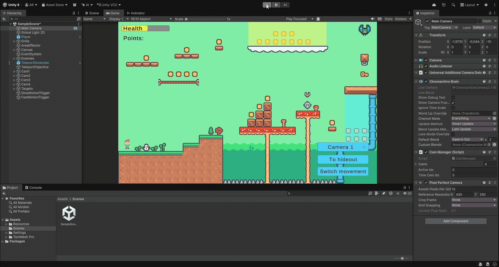

For this task, I modified the `CamManager` script to include a public method that changes the game's `timeScale`, setting the camera to a special configurable index if we want to trigger a certain virtual camera upon changing it:

```c#
public void SetGameSpeed(float timeScale)
{
    Time.timeScale = timeScale;
    if (timeScale != 1.0f)
    {
        SetActiveCam(timeCamIdx);
    }
}
```

This method is meant to be accessed via a new [`TimeScaleTrigger`](Assets/Resources/Scripts/Triggers/TimeScaleTrigger.cs) script, which is assigned to the new trigger objects in the scene:

```c#
using UnityEngine;

[RequireComponent (typeof(Collider2D))]
public class TimeScaleTrigger : MonoBehaviour
{
    public CamManager camManager;
    public bool isSlowMo = false;

    void OnTriggerEnter2D(Collider2D other)
    {
        if (other.gameObject.layer == 0) { // player
            camManager.SetGameSpeed(isSlowMo ? 0.5f : 2.0f);
        } 
    }

    void OnTriggerExit2D(Collider2D other)
    {
        if (other.gameObject.layer == 0) { // player
            camManager.SetGameSpeed(1.0f);
        }
    }
}
```

The same script is used for both slow (yellow) and fast (cyan) motion. When a player enters the trigger zone, the game's speed is changed accordingly.

## Task 7

> Create a script to exchange the active camera: one will be confined and the other won't. When the character collides with a scene element, the exchange is performed.


This task is even simpler. I added a new [`CamChangeTrigger`](Assets/Resources/Scripts/Triggers/CamChangeTrigger.cs) whose only job is to switch the priorities of the two cameras it is assigned when the player enters or exits a given area:

```c#
using Unity.Cinemachine;
using UnityEngine;

[RequireComponent (typeof(Collider2D))]
public class CamChangeTrigger : MonoBehaviour
{
    public CinemachineCamera cam1, cam2;
    public const int activePriority = 5000;
    public const int inactivePriority = 0;

    void OnTriggerEnter2D(Collider2D other)
    {
        if (other.gameObject.layer == 0) { // player
            cam1.Priority = inactivePriority;
            cam2.Priority = activePriority;
        }
    }

    void OnTriggerExit2D(Collider2D other)
    {
        if (other.gameObject.layer == 0) { // player
            cam1.Priority = activePriority;
            cam2.Priority = inactivePriority;
        }
    }
}
```

Note that this trigger's collider is set to cover the entire sky section of the scene.